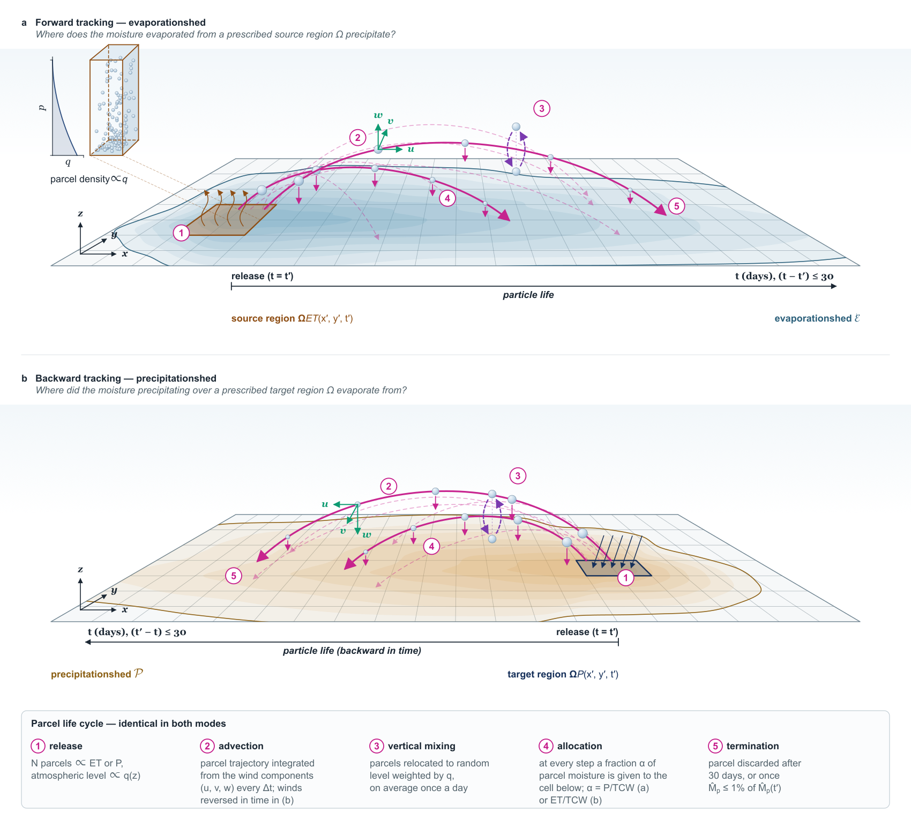

# UTrack: Lagrangian Atmospheric Moisture Tracking Model
[](https://github.com/vittorio-giordano/UTrack/releases)
[](https://doi.org/10.5281/zenodo.22706884)
[](LICENSE)
[](https://www.python.org/)
[](https://github.com/astral-sh/ruff)

UTrack is a Lagrangian moisture tracking model designed to diagnose surface evaporative moisture sources (precipitationshed) and precipitation sinks (evaporationshed) using global atmospheric reanalysis datasets.

## citation

If you use this model or code in your research, please cite our validation study and the associated repository:

**UTrack Evaluation:**
> Giordano V., et al. (2026). *Novel validation and performance assessment framework for atmospheric moisture tracking approaches: the case of UTrack*. Geoscientific Model Development (under review).

**Software repository archive:**
> Giordano V. (2026). *UTrack Lagrangian atmospheric moisture tracking model - code and validation routines for "Novel validation and performance assessment framework for atmospheric moisture tracking approaches: the case of UTrack"*. Zenodo. https://doi.org/10.5281/zenodo.22706884

**Github link: https://github.com/vittorio-giordano/UTrack** 

The original UTrack model was developed by Obbe Tuinenburg and Arie Staal:
* **Reference Paper:** Tuinenburg, O. A. and Staal, A.: *Tracking the global flows of atmospheric moisture and associated uncertainties*, Hydrol. Earth Syst. Sci., 24, 2419–2435, https://doi.org/10.5194/hess-24-2419-2020, 2020.
* **Original Repository:** [https://github.com/ObbeTuinenburg/UTrack-atmospheric-moisture](https://github.com/ObbeTuinenburg/UTrack-atmospheric-moisture)

The current version was developed to perform the validation and sensitivity anlysis presented in:

> Giordano [Surname], et al. (2026). *[Title of your GMD Paper]*. Geoscientific Model Development (under review).

This implementation refactors the computational architecture and array operations using Numba JIT multi-threading and cloud-native chunked data streaming, maintaining physical consistency while reducing memory consumption and runtime.



---

## Key Features

* **Parallelization:** Core parcel advection, linear interpolation, and moisture allocation routines are JIT-compiled with Numba (`@njit(parallel=True)`), executing at speeds comparable to compiled C.
* **Cloud Data Streaming:** Directly streams ERA5 reanalysis fields from Google Cloud ARCO ERA5 Zarr archives without requiring local downloads.
* **Diagnostic & Initialization:** The validation framework proposed by Giordano et al. (2016) is implemented in the scripts.

---

## Repository Structure

```text
UTRACK/
├── config/
│   └── config_bwdmix24.yml        # Simulation parameters (domain, physics, numerics)
├── examples/
│   └── plot_paper_figures.ipynb   # Jupyter notebook to inspect and visualize outputs
├── slurm/
│   └── SLURM.sh                   # Batch submission script for HPC environments
├── src/
│   ├── UTrack_SPINUP_tracking_indic_diagn_interp.py   # Main simulation execution driver
│   └── utrack_functions.py        # Advection, interpolation, and physical kernels
├── .gitignore
├── CITATION.cff
├── LICENSE
├── README.md
└── requirements.txt
```

---

## Installation & Environment Setup

### 1. Clone the Repository
```bash
git clone [https://github.com/YourUsername/UTrack.git](https://github.com/YourUsername/UTrack.git)
cd UTrack
```

### 2. Set Up Python Environment

**Option A: Using venv & pip**
```bash
python -m venv .venv

# Activate environment:
source .venv/bin/activate       # On Linux/macOS
# .venv\Scripts\activate        # On Windows

pip install -r requirements.txt
```

**Option B: Using Conda**
```bash
conda create -n utrack_env python=3.10 -y
conda activate utrack_env
pip install -r requirements.txt
```

---

## Running the Model

### 1. Local Execution (Workstation / Laptop)
Run the tracking driver directly from the repository root, passing the configuration file, target year, and target month via CLI arguments:

```bash
python src/UTrack_SPINUP_tracking_indic_diagn_interp.py \
    --config config/config_bwdmix24.yml \
    --year 2024 \
    --month 05
```

#### RAM Optimization (Chunk Sizing):
The cloud streaming engine defaults to downloading 24-hour data chunks, requiring ~40 GB of RAM. For local workstations with limited memory, you can lower this to 6-hour chunks (requiring ~10 GB RAM). To do so, modify the *Meteo class* in *src/UTrack_SPINUP_functions_indic_diagn_interp.py*, specifically the functions *_load_daily_buffer()* and *load_data()*

### 2. HPC Execution (SLURM Batch Job)
For cluster environments, submit the sanitized batch script (passing the config and python script names as arguments):

```bash
sbatch slurm/SLURM.sh config_bwdmix24.yml src/UTrack_SPINUP_tracking_indic_diagn_interp.py
```

---


